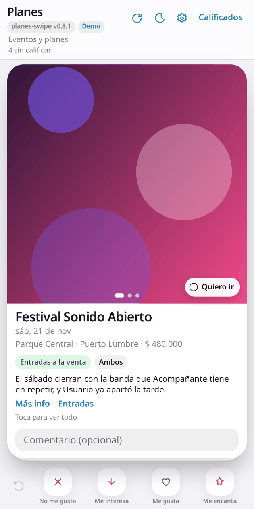

# 💖 planes-swipe

> Califica eventos y planes al estilo Tinder, conectado a tu propia hoja de Google.

**[▶ Ver demo](https://juliangdeveloper.github.io/planes-swipe/?demo=1)** · datos de ejemplo, sin conectar nada



## Cómo se usa
- Desliza cada plan: izquierda **No me gusta**, abajo **Me interesa**, derecha **Me gusta**, arriba **Me encanta** (o usa los botones).
- Agrega un comentario opcional y deshaz la última calificación si te equivocas.
- Marca **Quiero ir** en los planes que no te quieres perder, sin necesidad de calificarlos.
- En **Calificados** revisas lo que ya votaste.
- Sin conexión, las calificaciones quedan en cola y se envían al volver la red.

## Conectar tu hoja
La app lee y escribe en una hoja de Google a través de un Apps Script que publicas tú. La URL y la clave se guardan solo en tu navegador, nunca en el repositorio. Dentro de la app, **Cómo preparar la hoja** trae una plantilla `.xlsx` y el script listo para copiar.

1. En tu hoja: **Extensiones → Apps Script** y pega el contenido de [`apps-script/Code.gs`](apps-script/Code.gs).
2. En **Configuración del proyecto → Propiedades del script**, crea `SECRET` con una clave larga.
3. **Implementar → Nueva implementación → Aplicación web**, con **Ejecutar como: yo** y **Acceso: cualquier usuario**.
4. Copia la URL que termina en `/exec`, pégala en la app junto con la clave y pulsa **Probar conexión**.
5. Si cambias `Code.gs`: **Implementar → Gestionar implementaciones → Editar → Nueva versión** (la URL no cambia).

## Stack
JavaScript vanilla (módulos ES), service worker para uso offline y Google Apps Script como backend. Sin bundler.

```
python3 -m http.server 8000   # abrir http://localhost:8000/?demo=1
node --test                   # tests
```

Versión actual: `planes-swipe v0.8.1`.

---

Más proyectos: https://juliangdeveloper.github.io/

Hecho con ❤️ y 💖
